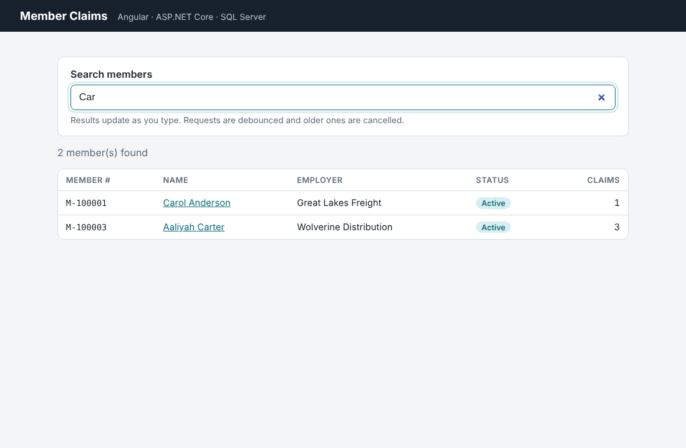
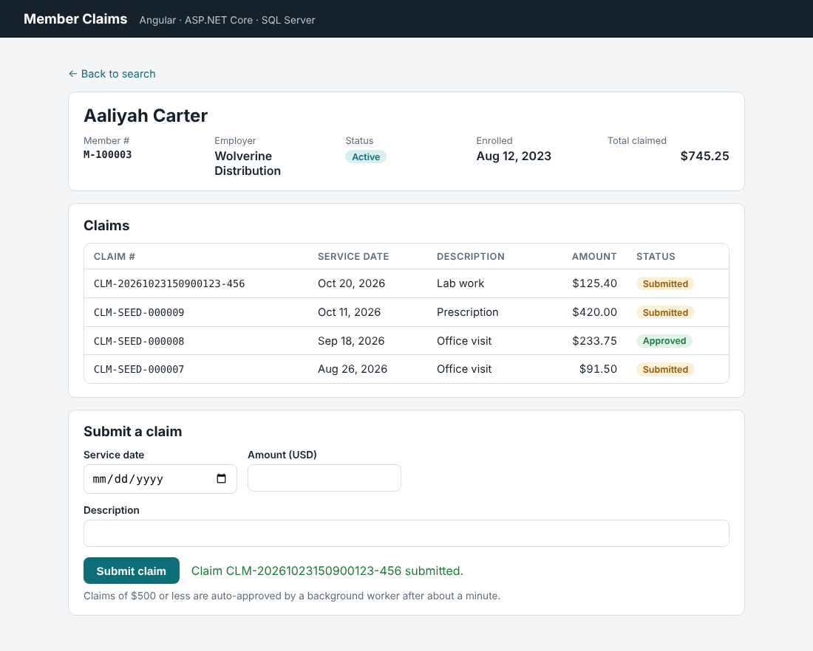

# Member Claims Demo

A small full-stack app for managing benefit-plan members and their claims, built to show an end-to-end Microsoft-stack workflow:

- **ASP.NET Core 8 Web API** with EF Core and SQL Server
- **GraphQL** endpoint (Hot Chocolate) on the same data
- **Background worker** that auto-approves small claims
- **Angular 19** front end with search-as-you-type, a detail page and a validated form
- **Python** loader that validates a CSV of claims and bulk-loads it into SQL Server




## Architecture

```
Angular (localhost:4200)  ──/api, /graphql (dev proxy)──►  ASP.NET Core API (localhost:5080)  ──EF Core──►  SQL Server (Docker, 1433)
                                                              ├─ REST controllers  (/api/members)
                                                              ├─ GraphQL           (/graphql)
                                                              └─ BackgroundService (auto-review)
Python CSV loader  ──pyodbc──────────────────────────────────────────────────────────────────►  SQL Server
```

```
api/MemberClaims.Api          Web API: Controllers, Services, Data (EF Core), GraphQL, Workers, Errors
api/MemberClaims.Api.Tests    xUnit tests for the service layer (EF Core InMemory)
web/                          Angular app (standalone components, RxJS, reactive forms)
scripts/                      Python CSV loader + tests + sample file
docker-compose.yml            Local SQL Server
```

## Run it locally

**Prerequisites:** .NET 8 SDK, Node.js 20+, Docker Desktop, Python 3.11+.

```bash
# 1. Start SQL Server
docker compose up -d

# 2. Start the API (creates the database and sample data on first run)
cd api/MemberClaims.Api
dotnet run
#   Swagger:  http://localhost:5080/swagger
#   GraphQL:  http://localhost:5080/graphql
#   Health:   http://localhost:5080/health

# 3. Start the Angular app (in a second terminal)
cd web
npm install
npm start
#   http://localhost:4200
```

### Run the tests

```bash
dotnet test                         # from the repo root
cd scripts && python -m pytest -q   # Python validation tests
```

### Load claims from CSV (Python)

```bash
cd scripts
python -m venv .venv && source .venv/bin/activate
pip install -r requirements.txt

python load_claims.py claims_sample.csv --dry-run   # validate only
python load_claims.py claims_sample.csv             # validate + load (needs ODBC Driver 18)
```

The ODBC driver on macOS: `brew tap microsoft/mssql-release https://github.com/Microsoft/homebrew-mssql-release && brew install msodbcsql18`.

Rejected rows are written to `claims_sample_rejected.csv` with the reason for each one.

### Sample GraphQL query

```graphql
{
  members(where: { lastName: { startsWith: "C" } }, order: { lastName: ASC }) {
    totalCount
    nodes {
      memberNumber
      firstName
      lastName
      claims { claimNumber amount status }
    }
  }
}
```

## Design notes

| Area | What I did and why |
| --- | --- |
| Layering | Thin controllers; business rules in `MemberService`; DTOs instead of exposing EF entities |
| Dependency injection | Services registered in `Program.cs`; `DbContext` is **scoped** (one per request) |
| Background work | `ClaimAutoReviewWorker` is a singleton, so it uses `IServiceScopeFactory` to create a new scope and `DbContext` per run, which avoids a captive dependency |
| Query performance | `Select` projections so EF builds one query (no N+1); `StartsWith` becomes a sargable `LIKE 'x%'` backed by an index; `AsNoTracking` for reads; paging |
| Errors | One `IExceptionHandler` maps exceptions to ProblemDetails: 404, 422 business rules, 409 concurrency, 500 without leaking details |
| Data integrity | `decimal(18,2)` for money; unique keys on member and claim numbers; `rowversion` for optimistic concurrency |
| Angular search | `debounceTime` + `distinctUntilChanged` + `switchMap` so typing sends few requests and stale responses can't overwrite newer results |
| Angular structure | Standalone components, a typed `HttpClient` service, a lazy-loaded detail route, signals for component state, and reactive forms with validation (the API validates again) |
| GraphQL | Hot Chocolate with projections, filtering, sorting and paging; requested fields become one SQL query |
| Python ETL | pandas validation, then a single member lookup, a bulk insert in one transaction, and a rejected-rows report. It follows the same pattern as SSIS/ADF staging loads |

## What I'd add for production

EF Core migrations deployed as reviewed SQL scripts; authentication with Entra ID or Cognito plus policy-based authorization; structured logging (Serilog) and Application Insights or CloudWatch; integration tests with `WebApplicationFactory` and Testcontainers; and a CI pipeline (GitHub Actions) that builds, tests and deploys containers.

## Author

**Ahmed Ibrahim** · Senior .NET / Full-Stack Developer
[LinkedIn](https://www.linkedin.com/in/ahmed-badr-ibrahim) · ahmadbadr@gmail.com

Licensed under the [MIT License](LICENSE).
